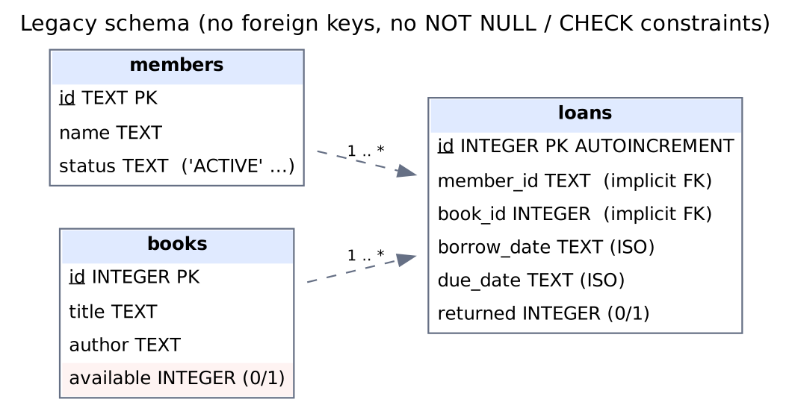
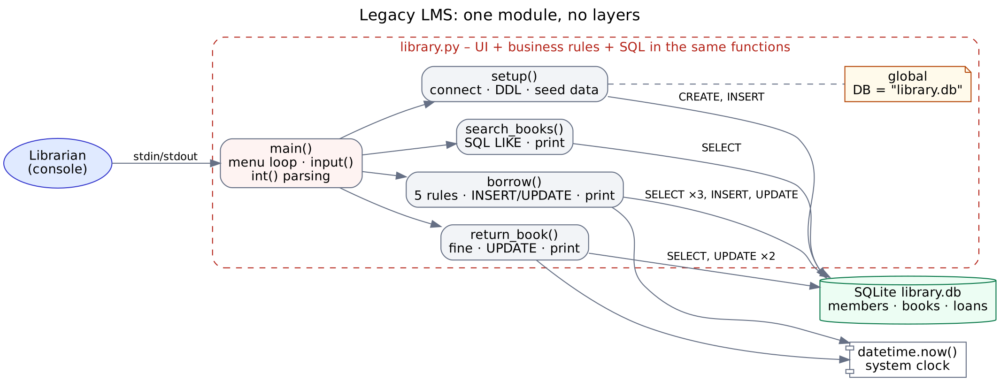

# Phase 1 – Program Comprehension & Legacy-System Analysis

Target: `library.py` at commit 01: 214 lines, 99 logical lines, 5 functions, 0 classes, no comments or documentation. The code was **not changed** in this phase.

## 1. How we studied the code

| Technique (course chapter) | What we did |
|---|---|
| Reverse engineering, 6 IEEE steps (Ch 4) | (1) partitioned the code into units (functions); (2) described each unit's meaning; (3) noted each unit's inputs and outputs; (4) described how the units connect; (5) described the application; (6) drew the internal structure |
| Top-down comprehension (Ch 8, Soloway & Ehrlich) | Started from requirements R1–R6 as hypotheses and searched the code for **beacons** that confirm them (e.g. `status`, `timedelta(days=14)`, `COUNT(*)`) |
| Bottom-up comprehension (Ch 8, Pennington) | Read each function line by line and grouped related lines into **chunks** (e.g. "check member", "create loan") |
| Opportunistic / integrated model (Ch 8) | Switched between the two above as needed |
| Control-flow analysis: call graph (Ch 4) | Which function calls which (§6) |
| Data-flow analysis (Ch 4) | Which function reads or writes which table (CRUD matrix, §6) |
| Visualization (Ch 4, 8) | Architecture and database diagrams |
| Program metrics (Ch 4) | Size and McCabe cyclomatic complexity with `radon` |
| Running the program | Recorded its behaviour in `tests/regression_tests.py` (20 tests) |

## 2. Requirements confirmed from the code

| Req | Statement | Where in `library.py` | Status and observations |
|---|---|---|---|
| R1 | Active members can borrow | `borrow()` lines 85–91 | Confirmed. Status must equal exactly `"ACTIVE"` (capital letters) |
| R2 | Maximum 3 books | `borrow()` lines 108–116 | Confirmed. Counts loans with `returned=0`; `3` is hard-coded |
| R3 | Borrow only when available | `borrow()` lines 93–106, 133–136 | Confirmed. `available` is a 0/1 flag, so only one copy per book |
| R4 | 14-day period | `borrow()` lines 118–119 | Confirmed. `timedelta(days=14)` is hard-coded |
| R5 | Fine for late returns | `return_book()` lines 158–179 | Partly. 1 unit per whole day late; the fine is only printed, never stored |
| R6 | Search books | `search_books()` lines 60–75 | Confirmed. Title or author contains the text, ignoring case |

## 3. Business rules

| ID | Rule | Explicit / implicit |
|---|---|---|
| BR-1 | The member must exist | explicit |
| BR-2 | The member status must be exactly `ACTIVE` (`active` is refused) | implicit detail |
| BR-3 | The book must exist | explicit |
| BR-4 | The book must be available (`available = 1`) | explicit |
| BR-5 | A member may have at most 3 unreturned loans | explicit |
| BR-6 | Checks run in a fixed order: member → active → book → available → limit, which decides the message shown | implicit |
| BR-7 | Fine = whole days late × 1; part of a day is free | implicit detail |
| BR-8 | Only the member who borrowed a book can return it | implicit |
| BR-9 | A suspended member can still return books | implicit |
| BR-10 | Returning a book makes it available again | explicit |
| BR-11 | Loans are never deleted; they are marked `returned = 1` (history kept) | implicit |
| BR-12 | Search matches title **or** author, ignoring case | implicit detail |
| BR-13 | Fines are not stored, so unpaid fines never stop borrowing | implicit |

## 4. Database structure

| Table | Columns | Problems |
|---|---|---|
| `members` | id (PK), name, status | `status` is free text; sample members are inserted by `setup()` |
| `books` | id (PK), title, author, available (0/1) | Cannot store more than one copy; `available` repeats information that is already in `loans` |
| `loans` | id (PK), member_id, book_id, borrow_date, due_date, returned (0/1) | No foreign keys; no return date; no fine column |

## 5. Current architecture

The system is **one module** with no layers. Every function mixes three jobs: talking to the user (`print`/`input`), applying business rules, and running SQL directly on SQLite.

## 6. Module/function responsibility table

| Function | Lines | Cyclomatic complexity | Responsibilities | Tables used (C/R/U) |
|---|---|---|---|---|
| `setup()` | 55 | 1 | open the database, create tables, insert sample data | members C, books C, loans C |
| `search_books()` | 16 | 2 | query books, print results | books R |
| `borrow()` | 67 | 6 | 5 checks, due date, create loan, update book, print | members R; books R/U; loans R/C |
| `return_book()` | 39 | 4 | find loan, compute fine, close loan, free book, print | loans R/U; books U |
| `main()` | 31 | 6 | menu loop, read input, convert IDs, call the functions | – |

## 7. Dependency analysis

- **Call graph (control flow):** `main()` → `setup()`, `search_books()`, `borrow()`, `return_book()`. No other calls.
- **Data dependencies (CRUD):** the `books` table is used by 4 of the 5 functions, and `loans` by 3. Any change to how books or the database work therefore reaches almost every function (high **ripple effect**, Ch 6).
- **External dependencies:** `sqlite3` (4 functions, 17 SQL statements), `datetime.now()` (2 functions), `print` (4 functions), `input` (`main`).
- **Global variable:** `DB = "library.db"` is shared by all code. A change to it propagates to every module that uses it (inter-module change propagation, Ch 6).
- **Order dependency:** `setup()` must run before anything else, because it creates the tables.

## 8. Code smells

| ID | Smell | Evidence |
|---|---|---|
| S1 | Long Method | `borrow()`: 67 lines, 5 checks + database writes + printing, complexity 6 |
| S2 | Mixed responsibilities | every function prints, decides rules and runs SQL |
| S3 | Direct DB access | 17 SQL statements spread over 4 functions |
| S4 | Primitive data | rows used as `row[0]`, `member[1]`; dates stored as text; 0/1 numbers used as true/false |
| S5 | Magic numbers / strings | `3`, `14`, fine rate `1`, `"ACTIVE"` written directly in the code |
| S6 | Duplicated Code | "Member ID / Book ID" input repeated in `main()`; the cursor/execute/commit pattern repeated |
| S7 | Global variable | `DB` file name shared by all functions |
| S8 | No comments, no documentation | 0 comment lines |

**Defects and gaps found:** **D1:** typing letters as a Book ID crashes the program (`ValueError`). **D2:** fines are never saved. **D3:** the actual return date is not saved.

## 9. Legacy-system assessment (CLO 2.1)

**Legacy features (Ch 5):** the LMS is small and written in a modern language. It does show the typical legacy problems: no documentation, a degraded structure and poor data management (no constraints). It is also hard to extend, because every change ripples through all functions.

**Portfolio analysis (Ch 5):** the business value is **high**, because it is the library's core service and its rules are correct. The technical quality is **low**. That places it in **Quadrant 4**, a candidate for redevelopment or reengineering rather than replacement with a product.

| Option (Ch 5) | Suitable? | Reason |
|---|---|---|
| Freeze | No | The library needs the two maintenance requests |
| Outsource | No | A small system that the team can maintain itself |
| Carry on maintenance as it is | No | Each change would touch every function (S2, S3) |
| Discard and redevelop | No | Risks losing the hidden rules BR-6…BR-13; the logic is correct |
| Wrap | No | Hides the code but does not fix its structure |
| Migrate | Partly | MR-02 needs a database change, but first the system must be split into parts |

**Decision: reengineer**, then keep maintaining it. Following Ch 4: *Reengineering = Reverse engineering + Δ + Forward engineering*. Phase 1 is the reverse engineering. Phases 2–3 are the alterations (Δ). Each commit is an interim version, which is the **incremental** reengineering approach.
