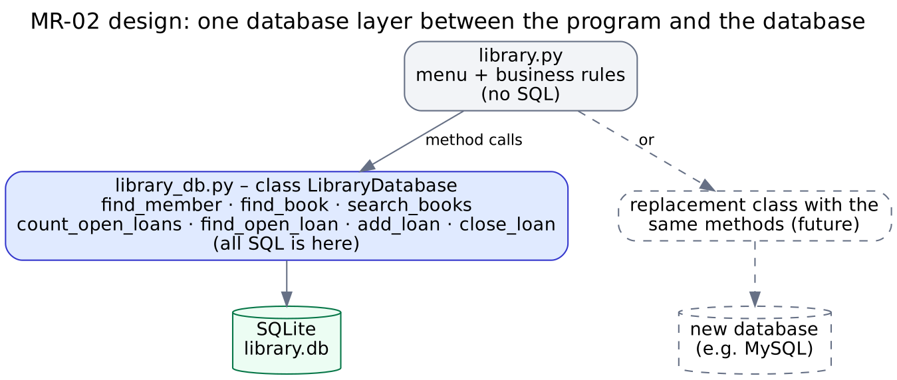

# Phase 2 – Maintenance Requests

Each request was handled with the IEEE/EIA 1219 maintenance process (Ch 3):

- **Problem identification:** classify the request.
- **Analysis:** impact analysis.
- **Design:** the proposed design.
- **Implementation:** commit 03.
- **System test:** the regression tests.

The impact analysis follows Ch 6. We find the **Starting Impact Set (SIS)** by searching the code for the request's concept. We extend it to the **Candidate Impact Set (CIS)** using the call graph and the table usage (CRUD) from Phase 1, which give direct and indirect impacts. After implementing, we compare with the **Actual Impact Set (AIS)** and compute the discovered set (DIS), the false positives (FPIS), recall and precision.

- Recall = |CIS ∩ AIS| / |AIS|
- Precision = |CIS ∩ AIS| / |CIS|
- FPIS = (CIS ∪ DIS) \ AIS

---

## MR-01 – Multiple copies of each book

> *The library has purchased multiple copies of each book. The system must support more than one available copy.*

### Classification
- **Intention-based:** **Perfective.** The users (the library) need the system to do more for them. Nothing is broken, so it is not corrective, and the technical environment did not change, so it is not adaptive.
- **Activity-based (Kitchenham):** **Enhancement.** It changes an existing requirement (R3: a book is available or not) and adds a new one (several copies).

### Impact analysis

| Set | Contents | Size |
|---|---|---|
| SIS (search for `available`) | `books` table, `setup()`, `search_books()`, `borrow()`, `return_book()` | 5 |
| CIS (SIS + direct/indirect impacts) | SIS + `main()` (calls them) + `loans` table (written by borrow/return) | 7 |
| AIS (actually changed) | `books` table, `setup()`, `search_books()`, `borrow()`, `return_book()`, regression tests | 6 |
| DIS (found while implementing) | regression tests: 1 expected output changed, 4 tests added | 1 |
| FPIS | `main()`, `loans` table (not changed) | 2 |

**Recall** = 5/6 = **0.83**; **Precision** = 5/7 = **0.71**.

- **Affected components:** `setup()` (table definition and sample data), `search_books()` (shows copies), `borrow()` (counts copies, new rule), `return_book()` (puts a copy back).
- **Affected database tables:**
  - `books`: new column `copies`, and `available` now holds a **number** of copies instead of 0/1.
  - `loans`: no structural change, but its rows are now read by the new rule BR-14.
- **Hidden impact found:** with several copies, a member could borrow the same book twice, and returning it would then be ambiguous. The old system made this impossible, so we kept it as a new rule, **BR-14: a member may hold one copy of a book at a time.**

### Proposed design

| Option | Description | Decision |
|---|---|---|
| A | Add `copies` to `books`; `available` counts the copies on the shelf | **Chosen.** Smallest change; existing data stays valid (1 copy) |
| B | New table with one row per physical copy; loans point to a copy | Rejected for now: much larger impact on `loans` and on returning |

- Borrow: if `available > 0`, reduce it by 1 **in the same save** as creating the loan.
- Return: increase `available` by 1, never above `copies`.
- Search shows `Available: 2 of 3 copies`.
- A database created by the old version is upgraded on start-up by adding the `copies` column (default 1).

### Implementation and testing
Commit 03. The regression tests pass: 20 from Phase 1, one of them with the intended new output, plus 4 new MR-01 tests, including one that upgrades an old database.

---

## MR-02 – Replace the database implementation

> *The university wants to replace the current database implementation. The business functionality should remain unchanged.*

### Classification
- **Intention-based:** **Adaptive.** The system must adapt to a change in its data and processing environment, a new database.
- **Activity-based (Kitchenham):** **Enhancement** that changes the implementation without changing the requirements.

### Impact analysis

| Set | Contents | Size |
|---|---|---|
| SIS (search for `sqlite3`, `execute`, `DB`) | global `DB`, `setup()`, `search_books()`, `borrow()`, `return_book()` | 5 |
| CIS | SIS + `main()` (calls `setup()`, closes the database) + tables `members`, `books`, `loans` | 9 |
| AIS | global `DB` (removed), `setup()`, `search_books()`, `borrow()`, `return_book()`, the three table definitions (moved) | 8 |
| DIS | – | 0 |
| FPIS | `main()` (its code did not need to change) | 1 |

**Recall** = 8/8 = **1.0**; **Precision** = 8/9 = **0.89**. New component added: `library_db.py`.

- **Affected components:** all four functions that contained SQL, which is all of the business logic.
- **Affected database tables:** `members`, `books` and `loans`. All three must exist in the new database with the same columns. Their logical structure does not change.

### Proposed design
The legacy system is **non-decomposable** (Ch 5): the user interface, the logic and the database are mixed in every function, so the database cannot be replaced on its own. The design first makes it **decomposable**. All database access moves into one **database layer**, the class `LibraryDatabase`, which acts like a database wrapper or gateway (Ch 5).

- `library.py` asks the layer for what it needs (`find_member`, `add_loan`, …). It no longer contains SQL or imports `sqlite3`.
- To replace the database, a new class with the **same methods** is written for the new database (for example MySQL). The data is moved first and then the program switches to the new class, similar to the *database first* migration method (Ch 5). The business functions do not change.

### Implementation and testing
Commit 03: new file `library_db.py`. After the change, the number of business functions containing SQL dropped from **4 to 0**. All 24 regression tests pass, which shows the business functionality is unchanged.
