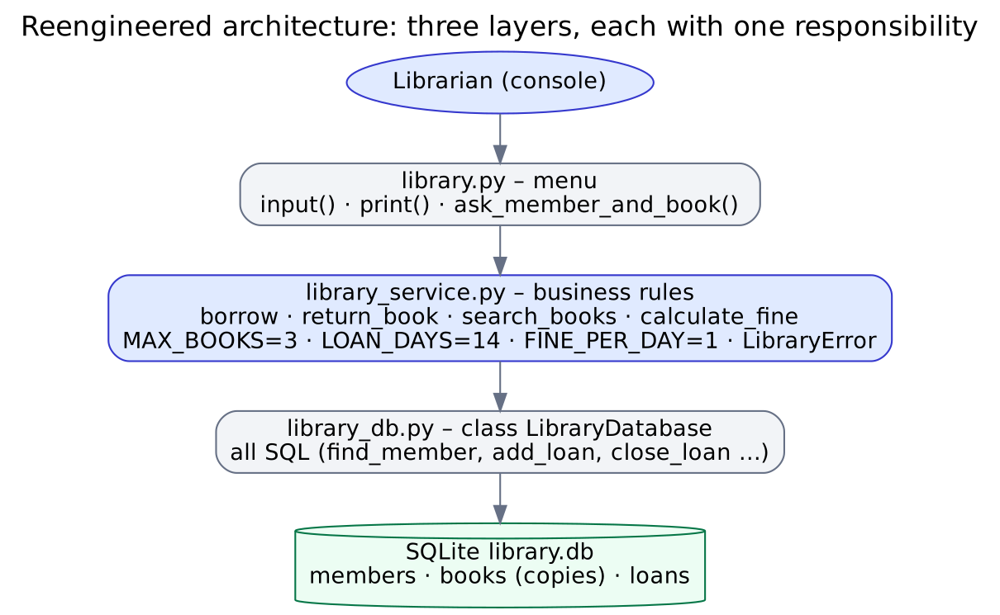

# Phase 3 – Refactoring

**Task:** `borrow()` has become difficult to maintain. Refactor the system while preserving its externally observable behaviour.

We followed the refactoring process from Ch 7.

## 1. Identify what to refactor (code smells)

After MR-01, `borrow()` was 41 lines long with cyclomatic complexity **8**, the highest in the program. The smells to remove come from Phase 1:

| Smell (Phase 1) | Where |
|---|---|
| S1 Long Method | `borrow()`: seven checks, date calculation, database call and printing in one function |
| S2 Mixed responsibilities | `borrow()`, `return_book()` and `search_books()` decide the rules **and** print |
| S5 Magic numbers | `3`, `14`, fine rate `1`, `"ACTIVE"` written inside the code |
| S6 Duplicated Code | the "Member ID / Book ID" input lines repeated in `main()` |

(S3 Direct DB access and part of S4 Primitive data were already removed by MR-02: the database layer returns rows that are read by column name.)

## 2. Ensure that refactoring preserves the behaviour

Before changing anything we ran the 24 regression tests (input/output tests). After each refactoring step we ran them again. The test file was **not changed** in this commit (`git diff 03 04 -- tests/` is empty), and all 24 still pass. The messages, the order of the checks and even the known crash D1 are unchanged. D1 is fixed later as separate corrective maintenance, because fixing it changes behaviour.

## 3. Apply the refactorings

| ID | Refactoring | Smell removed | Result |
|---|---|---|---|
| RF-1 | **Extract Method** | Long Method | `borrow()` calls one small function per rule: `check_member`, `check_book`, `check_not_holding`, `check_limit`, `record_loan`; `calculate_fine` extracted from `return_book` |
| RF-2 | **Separate the user interface from the business logic** | Mixed responsibilities | `library_service.py` holds the rules and raises `LibraryError`; only `library.py` uses `input()`/`print()` |
| RF-3 | **Replace magic numbers with named constants** | Magic numbers / primitive data | `MAX_BOOKS = 3`, `LOAN_DAYS = 14`, `FINE_PER_DAY = 1`, `ACTIVE = "ACTIVE"` |
| RF-4 | **Remove duplicated code** | Duplicated Code | one `ask_member_and_book()` used by Borrow and Return |

**`borrow()` before** (commit 03, abridged):
```python
def borrow(db, member_id, book_id):
    member = db.find_member(member_id)
    if not member:
        print("Member not found")
        return False
    if member["status"] != "ACTIVE":
        print("Member is not active")
        return False
    ...  # 5 more checks, date calculation, database call, print
```

**`borrow()` after** (`library_service.py`):
```python
def borrow(db, member_id, book_id):
    check_member(db, member_id)                      # BR-1, BR-2
    check_book(db, book_id)                          # BR-3, BR-4
    check_not_holding(db, member_id, book_id)        # BR-14
    check_limit(db, member_id)                       # BR-5
    return record_loan(db, member_id, book_id)       # R4
```

## 4. Evaluate the impact on quality

| Measure | Commit 03 | Commit 04 |
|---|---|---|
| Lines in `borrow()` | 41 | 7 |
| Cyclomatic complexity of `borrow()` | 8 | **1** |
| Highest complexity of any business-rule function | 8 | 3 |
| Functions that both decide rules and print | 3 | **0** |
| Regression tests passing | 24 / 24 | 24 / 24 |

## 5. Keep documents consistent

README and diagrams were updated to the new structure:


