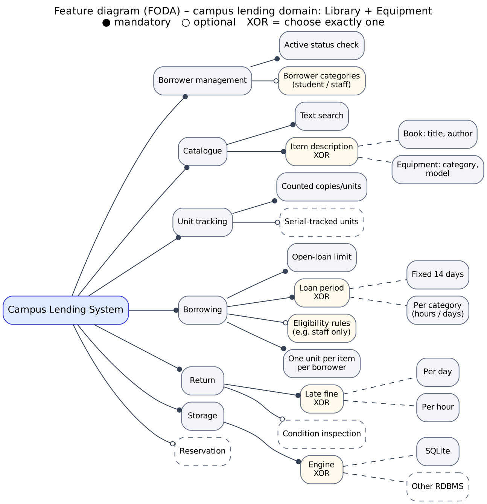
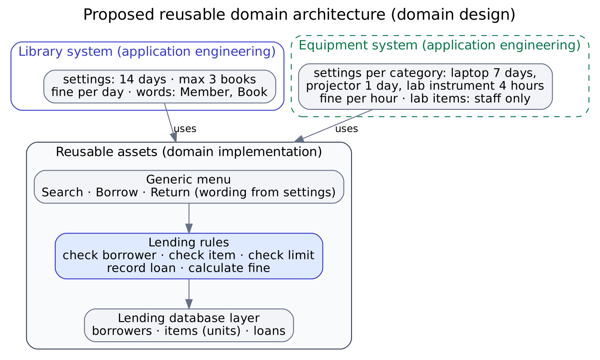

# Phase 4 – Reuse & Domain Engineering: Equipment Borrowing System

The university wants an **Equipment Borrowing System (EBS)** for laptops, projectors, cameras and laboratory instruments. Following Ch 9, we treat the LMS and the EBS as a **program family** (Parnas): programs with many common features. We apply **domain engineering** (development *for* reuse) so that both systems can be built by **application engineering** (development *with* reuse).

## 1. Domain analysis

**Step 1 – Product family.** "Campus lending": systems that lend a limited stock of identical units to eligible people for a limited time. The members are the Library Management System and the Equipment Borrowing System.

**Step 2 – Common and variable features** (FODA method, Ch 9)

| # | Common feature | LMS | EBS |
|---|---|---|---|
| C1 | Borrowers with a status; only active borrowers may borrow | ✓ | ✓ |
| C2 | Catalogue of items that can be searched | ✓ | ✓ |
| C3 | Several identical units of an item (copies / units) | ✓ (MR-01) | ✓ |
| C4 | Borrow checks: borrower exists and is active → item exists and is available → not already holding it → under the limit | ✓ | ✓ |
| C5 | Due date = borrow time + loan period | ✓ | ✓ |
| C6 | Return closes the loan and frees one unit | ✓ | ✓ |
| C7 | Fine for late return | ✓ | ✓ |
| C8 | Maximum number of items per borrower | ✓ | ✓ |
| C9 | Loan history kept; data reached through a database layer | ✓ | ✓ |

| # | Variable feature | LMS | EBS (example values, to confirm with the university) |
|---|---|---|---|
| V1 | Item description | title, author | category, model |
| V2 | Loan period | 14 days | per category: laptop 7 days, camera 3 days, projector 1 day, lab instrument 4 hours |
| V3 | Fine unit | per day | per hour for short loans |
| V4 | Maximum items per borrower | 3 | 2 |
| V5 | Extra eligibility | none | lab instruments only for staff |
| V6 | Borrower types | members | students and staff |
| V7 | Wording on screen | "Member", "Book" | "Borrower", "Equipment" |
| V8 | Optional features | – | condition check on return, reservation |

**Step 3 – Product family specification.** Every product of the family provides C1–C9. Each product chooses its values for V1–V7 and may add the optional features in V8.

## 2. Domain design: proposed reusable domain architecture

We propose a **generic architecture** for the family, based on the same three layers as the reengineered LMS (Phase 3): menu, rules, database layer. The variable features become **settings** that each product supplies. The rules themselves do not change between products.

**Plan to create each system from the reusable assets.** Give the product its settings (V1–V7), reuse the menu, rules and database layer, and add only what is new to it (for example the staff-only check and the per-hour fine for the EBS).

## 3. Domain implementation (plan)

| Reusable asset | Comes from (today's LMS) | Generalisation needed |
|---|---|---|
| Lending rules | `library_service.py` (`check_member`, `check_book`, `check_limit`, `record_loan`, `calculate_fine`) | constants (`MAX_BOOKS`, `LOAN_DAYS`, `FINE_PER_DAY`) become settings; "book" becomes "item"; fine per day **or** per hour |
| Database layer | `library_db.py` | tables `borrowers`, `items` (with units, category), `loans` |
| Menu | `library.py` | screen words come from the settings |

The assets would be kept in one shared component library that both systems use.

## 4. Reuse decisions

- **Reuse model: extractive** (Ch 9). We build the domain assets by extracting them from an existing, working product (the reengineered LMS), instead of designing for all possible variations upfront (proactive) or only when needed (reactive).
- **Types of reuse:** **architectural** (the three-layer structure), **design** (the borrow/return rules), **program** (the code) and **data** (one data format for borrowers, items and loans).
- **Reusability properties** (Ch 9) already gained in Phase 3: high cohesion (one responsibility per module), low coupling (rules do not depend on SQL), understandability and adaptability (rules driven by named constants).
- **Benefits:** a fix in the shared rules reaches both systems; the EBS is built faster and inherits rules that are already tested.

Building the EBS itself is **application engineering** and is outside this project. The brief asks only for the analysis and the proposed architecture.
